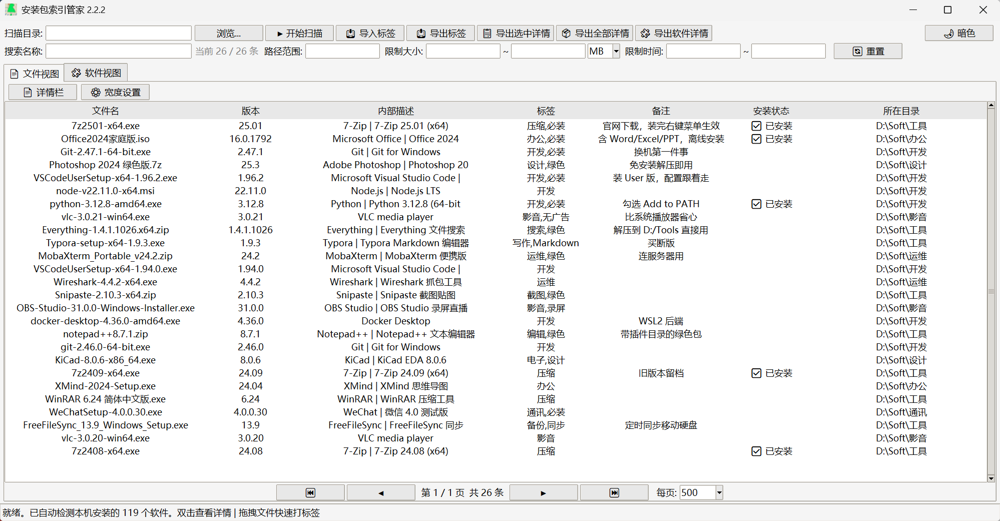
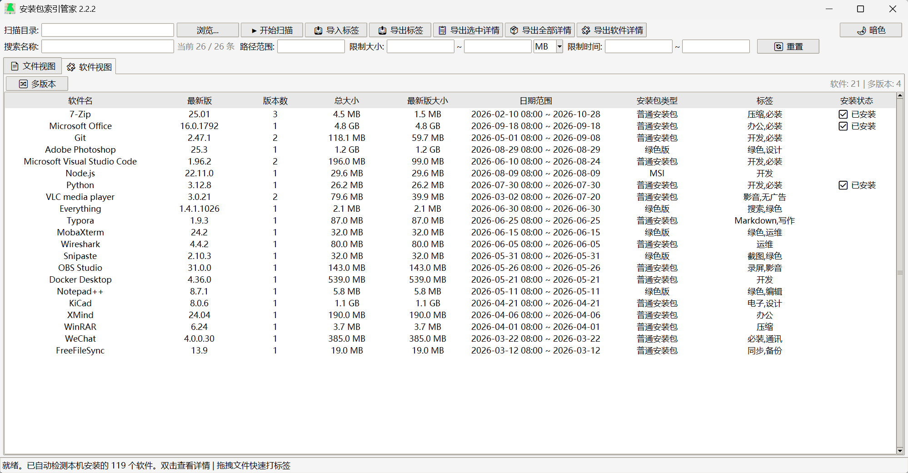
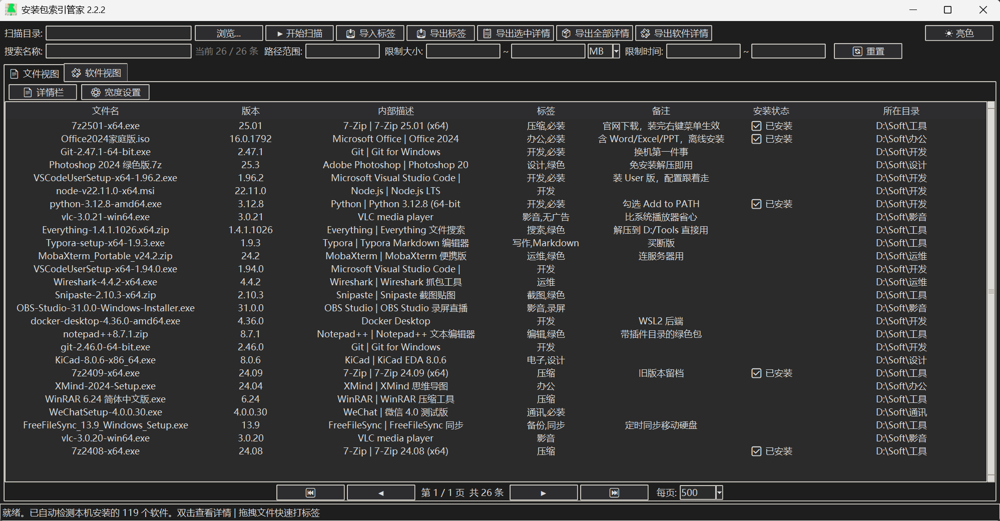
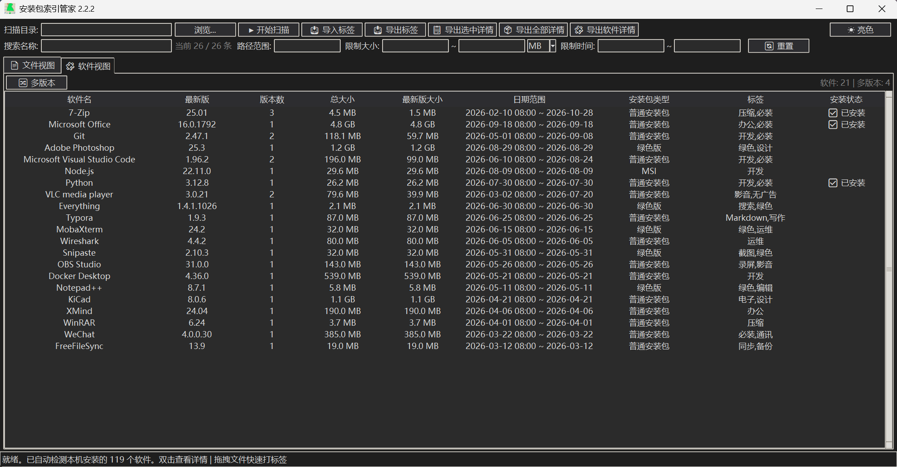

# PackManager · 安装包索引管家

**A local index for the installers you already own.** Point it at your drives, and every `exe / msi / zip / 7z / iso / apk / jar` you have ever downloaded becomes searchable, taggable and comparable — offline, in one window, no install and no admin rights.

[中文说明 ↓](#中文说明)

`Windows 10 / 11` · `Python 3.9+ (from source)` · `SQLite` · `single file, ~2000 lines`





<details>
<summary>Dark theme screenshots / 暗色主题截图</summary>





</details>

## Quick start

**Option A — download the exe**

Download `PackManager2.2.2-win64.zip` from [Releases](../../releases), unzip it anywhere and double-click `PackManager2.2.2.exe`. Nothing is installed, no administrator rights are needed, and the program writes only two files next to itself (see [Where your data lives](#where-your-data-lives)).

**Option B — run from source**

```bash
pip install -r requirements.txt
python PackManager2.2.2.py
```

Then type or paste some folders into **扫描目录 / Scan folders** (separate several with `;`), press **▶ 开始扫描 / Start scan**, and wait for the counter to stop. A few hundred thousand files is fine; re-scanning an unchanged folder skips all hashing and finishes in seconds.

## What it does

- **Scan** — walks any folder tree, skipping `$Recycle.Bin`, `System Volume Information`, `node_modules`, `.git`, `__pycache__`. Incremental: files whose size and mtime did not change are only re-stamped, never re-hashed.
- **Read metadata** — pulls `ProductName / FileDescription / FileVersion / ProductVersion / CompanyName` out of every Windows executable, and lists the first ~50 entries inside zip / 7z / rar archives (with a cp437 → GBK fix for Chinese zip entries).
- **Find** — substring search over file names, plus filters for path, size range (MB/GB) and modified-date range. `_` and `%` are treated literally, so `cpu-z_2.17` matches exactly what you meant.
- **Tag & note** — any file can carry free-form tags (`开发,必装`) and a note. Drag files from Explorer onto the window to tag them in bulk; right-click for batch tag/note editing.
- **Software view** — groups your files by software: newest version, number of versions kept, total size, size of the newest build, date range, detected installer type, tags. That is the "which version of 7-Zip do I actually still have on disk?" question, answered.
- **Do I have it installed?** — compares the index against the real uninstall registry (HKLM **and** HKCU, both 64- and 32-bit views) and marks files of software that is already installed. Handles name drift like `winrar-x64-624scp.exe` → *WinRAR*.
- **Installer type** — `MSI / APK / JAR / Inno Setup / NSIS / 绿色版 (portable) / 压缩包 (archive) / 普通安装包`. PE overlay signatures identify Inno and NSIS; archives containing a small set of loose `.exe` files are reported as portable builds.
- **Duplicates** — SHA-1 is computed only for files that share a size, so identical downloads are found without hashing the whole disk.
- **Export** — CSV of the current view, human-readable detail dumps (selected / all / software level), and a **tags JSON** that can be imported back later — a portable backup of your tags and notes.
- **Niceties** — dark theme that follows Windows, resizable/hideable columns, detail pane, drag-select over rows, virtual scrolling for large result sets.

Everything runs locally. Nothing is uploaded, no account, no telemetry, no network access at runtime (dependencies are fetched by pip only when running from source and something is missing).

## What it does **not** do

- **It is not a package manager.** It never downloads, installs, updates or silently uninstalls anything. No winget/choco/apt integration — it only reads what you already have.
- **It does not verify authenticity.** SHA-1 exists to spot duplicate files, not to prove a file is safe or unmodified.
- **It does not scan for malware** and it has no opinion about what is inside an installer.
- **It does not move, rename or delete your files.** Removing an entry only drops it from the index; the file stays on disk.
- **It does not watch folders in the background.** Scanning is manual (that is why it starts instantly and never eats CPU while idle).

## Keyboard shortcuts

| Shortcut | Action |
|---|---|
| `Ctrl+F` | Clear filters and focus the search box |
| `Ctrl+A` | Select all rows |
| `Ctrl+C` | Copy the full path of the selected file |
| `Ctrl+E` | Export detail of the selected rows |
| Drag files from Explorer | Drop them on the window to batch-tag them |

Right-click menu: view full details, run the program, open its folder, copy path, verify SHA-1, batch edit tags/notes, export, select all / invert, remove from index.

## Where your data lives

Everything is kept next to the program (the `.exe`, or the `.py` when run from source):

```
pack_index.db      SQLite index (plus -wal / -shm in WAL mode)
packmanager.log    rotating runtime log — check here if a window misbehaves
```

Move or delete those files and you start from scratch; your original installers are never touched. The database is plain SQLite, so you can query it with any SQLite client.

## Build your own exe

```bash
pip install pyinstaller
python PackManager2.2.2.py --build
```

Output goes to `dist/PackManager2.2.2.exe`. The build bundles `tkinterdnd2` and `py7zr` and embeds `app.ico`; it exits non-zero if PyInstaller fails.

## Requirements

- Windows 10 / 11 (the app reads `winreg` and `version.dll`; it does not run on Linux or macOS).
- Python 3.9+ only if you run from source. Tested on Python 3.14.
- `py7zr`, `rarfile`, `tkinterdnd2` — installed by `pip install -r requirements.txt`, or auto-installed on first launch from source.

## Known limitations

- **Version grouping is heuristic.** The software view groups by the executable's `ProductName`, falling back to a normalized filename. Installers that report no version info *and* are named only by build number (e.g. `7z2501-x64.exe` without metadata) can appear as separate groups.
- **RAR contents** need `unrar` or `bsdtar` on `PATH`; without it, `.rar` files are indexed by filename only.
- **Archive listing** is capped at the first ~50 entries — the software view uses it to tell "portable build" from "plain archive", which does not need a complete listing.
- **First scan of a big tree is the slow part.** Executable tails are read once to detect Inno/NSIS; results are cached per `(path, size, mtime)`.
- The UI is Chinese-first (with English labels for the main actions) and the code comments are in Chinese.

---

# 中文说明

**Windows 安装包索引管家：扫描硬盘里的 exe/msi/zip/7z/iso，建立可搜索、可打标签、可对比版本的本地索引。**

它能解决的是那种"我明明下载过这个软件，但不知道它在哪个盘、哪个版本"的麻烦：把所有安装包扫进一个 SQLite 索引，之后靠搜索、标签、软件视图来找。

## 快速开始

**方式一：下载 exe**

到 [Releases](../../releases) 下载 `PackManager2.2.2-win64.zip`，解压到哪儿都行，双击里面的 `PackManager2.2.2.exe` 就能用。免安装、不需要管理员权限，只会在程序旁边写两个文件（见 [数据存在哪](#数据存在哪)）。

**方式二：从源码运行**

```bash
pip install -r requirements.txt
python PackManager2.2.2.py
```

然后在 **扫描目录** 里填或粘贴几个文件夹（多个用 `;` 分隔），点 **▶ 开始扫描**。扫过一次之后再扫同一个目录，没变过的文件不再重复算哈希，几秒就能过完。

## 主要功能

- **扫描**：递归遍历任意目录，自动跳过 `$Recycle.Bin`、`System Volume Information`、`node_modules`、`.git`、`__pycache__`。增量更新：大小和修改时间都没变的文件只刷新"最近一次看到"，不重复算哈希。
- **读取元数据**：从每个 exe 里取出 `产品名 / 文件描述 / 文件版本 / 产品版本 / 公司名`，并读取 zip / 7z / rar 里前约 50 个文件名（含 cp437 → GBK 的乱码修正）。
- **搜索与筛选**：名称搜索，加路径范围、大小区间（MB/GB）、修改时间区间。`_` 和 `%` 按普通字符处理，搜 `cpu-z_2.17` 就只出这一条。
- **标签与备注**：任意文件都能打标签（如 `开发,必装`）和写备注；从资源管理器把文件拖进窗口即可批量打标签，右键可批量编辑。
- **软件视图**：按软件聚合，一行显示最新版本、保留了几个版本、总大小、最新版大小、日期范围、安装包类型、标签，以及 **"这台电脑装了没"**——直接比对注册表卸载项（HKLM + HKCU，含 64/32 位视图），像 `winrar-x64-624scp.exe` 这种名字也能认出是 WinRAR。
- **安装包类型识别**：`MSI / APK / JAR / Inno Setup / NSIS / 绿色版 / 压缩包 / 普通安装包`。Inno 和 NSIS 通过 PE 尾部特征判断；压缩包里只有少量散落的 exe 就判为绿色版。
- **重复文件**：只对大小相同的文件计算 SHA-1，既能找出重复下载，又不用把整块硬盘哈希一遍。
- **导出**：当前视图导 CSV、选中/全部/软件级导详情文本、标签备注导 JSON（可以再导入回来，当便携备份用）。
- **其它**：跟随系统设置的暗色主题、列宽可调可隐藏、详情栏、表格内拖拽框选、大数据量虚拟滚动。

全部离线运行：不联网、无账号、无统计上报（只有从源码运行时，缺依赖才会调用 pip 安装）。

## 它不做什么

- **它不是包管理器**，不负责下载、安装、升级、静默卸载，也不对接 winget/choco —— 它只整理你已有的东西。
- **它不做可信性校验**：SHA-1 只用于找重复文件，不代表文件安全或未被篡改。
- **它不查毒**，也不对安装包内容做任何评价。
- **它不动你的文件**：从索引移除只是删掉这条记录，硬盘上的文件原样保留。
- **它不做后台监控**：扫描是手动触发的，所以启动快、闲置时完全不占 CPU。

## 快捷键

| 快捷键 | 作用 |
|---|---|
| `Ctrl+F` | 清空筛选并聚焦搜索框 |
| `Ctrl+A` | 全选当前列表 |
| `Ctrl+C` | 复制选中文件的完整路径 |
| `Ctrl+E` | 导出选中行的详情 |
| 拖拽文件 | 从资源管理器拖到窗口上批量打标签 |

右键菜单：查看完整详情、运行程序、打开所在文件夹、复制完整路径、校验 SHA-1、批量编辑标签/备注、导出、全选/反选、从索引移除。

## 数据存在哪

所有数据都在程序旁边（exe 所在目录，或源码所在目录）：

```
pack_index.db      SQLite 索引（WAL 模式下另有 -wal / -shm 文件）
packmanager.log    运行日志，出现异常时先看这里
```

删掉它们就等于重置索引，你的安装包本身不会被改动。数据库是标准 SQLite，用任何 SQLite 客户端都能直接查。

## 自己打包 exe

```bash
pip install pyinstaller
python PackManager2.2.2.py --build
```

产物在 `dist/PackManager2.2.2.exe`。打包会自动带上 `tkinterdnd2`、`py7zr` 和 `app.ico`；PyInstaller 失败时以非零码退出，不会假装打包成功。

## 环境要求

- Windows 10 / 11（用到 `winreg` 和 `version.dll`，不能在 Linux / macOS 上跑）。
- 只有从源码运行时才需要 Python 3.9+，实测在 Python 3.14 下正常。
- `py7zr`、`rarfile`、`tkinterdnd2`：可用 `pip install -r requirements.txt` 安装，源码首次启动时也会自动补装。

## 已知限制

- **版本归组是启发式的**：软件视图优先用 exe 的 `ProductName` 归组，没有版本信息时退回归一化文件名。既没有版本信息、文件名又只有版本号（如 `7z2501-x64.exe`）的文件，有可能被拆成两组。
- **RAR 内部列表**需要 `PATH` 里有 `unrar` 或 `bsdtar`；没有的话 `.rar` 只按文件名建索引（功能不受影响，只是判断不了"绿色版/压缩包"）。
- **压缩包列表只取前约 50 项**，用来区分"绿色版"和"普通压缩包"已经够用。
- **首次扫描大树是最慢的一步**（要读每个 exe 的尾部来识别 Inno/NSIS）；结果按 `(路径, 大小, 修改时间)` 缓存，之后刷新很快。
- 界面以中文为主（主要按钮带英文），代码注释是中文。
